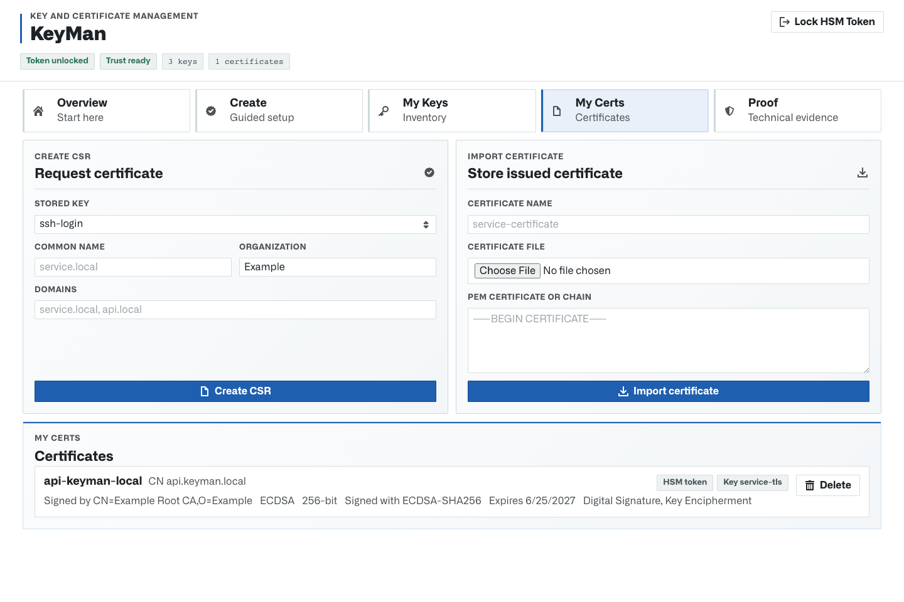

# keyman

Private keys are often the most important security boundary in a system, but
many development and integration workflows still treat them as ordinary files.
That creates a gap between how PKI is demonstrated and how production systems
are expected to behave.

Real deployments usually want private keys to stay inside a protected boundary:
an HSM, a smart card, a PKCS#11 token, or a TPM 2.0 device. The application
gets signing, encryption, certificate, attestation, or unlock behavior, but it
does not get to copy the private key material out into a local file.

`keyman` is a Go and TypeScript sandbox for that model. It provides a
management console, HTTP API, CLI, and Go library for creating and exercising
protected keys through PKCS#11/HSM and TPM 2.0 backends.

The default demo image runs everything in one container: the Go API, the
BlueprintJS management console, SoftHSM for PKCS#11, and `swtpm` for TPM 2.0.
That makes the project easy to run locally while still using the same kinds of
interfaces that real hardware-backed deployments use.

It is designed for teams that need to understand, prototype, or validate secure
key workflows for SSH login keys, TLS certificates, disk unlock secrets, VPN
identity, code signing, certificate requests, and certificate inventory without
starting from vendor-specific HSM tooling.



## Quick Start

Build and run the single-container demo:

```bash
make demo
```

Open:

```text
http://127.0.0.1:8080
```

The command builds `keyman:latest`, starts the container, and keeps it running
in the foreground. Press `Ctrl-C` to stop it.

The Makefile uses Docker when `docker` is available and falls back to Podman
otherwise.

Force Docker:

```bash
CONTAINER_RUNTIME=docker make demo
```

Force Podman:

```bash
CONTAINER_RUNTIME=podman make demo
```

Use a different local port:

```bash
PORT=5080 make demo
```

Then open:

```text
http://127.0.0.1:5080
```

The demo image initializes a local SoftHSM token named `KEYMAN`.

```text
HSM PIN: 1234
```

The TPM 2.0 side uses the software TPM started inside the same container and is
available without an HSM PIN.

Run the regular Go test suite:

```bash
make test
```

Build the web console and server binary:

```bash
make build
```

Run the SoftHSM-backed integration suite:

```bash
make test-integration
```

Run the CLI lifecycle demo against an initialized PKCS#11 token:

```bash
keyman -module /usr/lib/softhsm/libsofthsm2.so -token KEYMAN -pin 1234 lifecycle
```

Run the HTTP server against an initialized token:

```bash
keymand -module /usr/lib/softhsm/libsofthsm2.so -token KEYMAN
```

The server opens the token after the browser submits the PIN through the
management console.

## What It Does

`keyman` handles common protected-key workflows:

- Creates non-extractable AES-256-GCM, RSA-4096, ECDSA P-256, ML-DSA-65 and ML-KEM-768 keys.
- Stores key metadata alongside PKCS#11 objects.
- Rotates AES keys while preserving older decrypt versions.
- Encrypts and decrypts with versioned AES-GCM keys.
- Signs and verifies payloads with HSM-backed RSA, ECDSA, and ML-DSA-65 keys.
- Exposes HSM-backed keys through Go's `crypto.Signer` interface.
- Creates self-signed X.509 certificates using HSM-resident private keys.
- Creates CSRs from stored HSM keys.
- Imports PEM, DER, and certificate chains after checking for a matching key.
- Lists stored keys and certificates with backend, algorithm, key size, subject,
  issuer, validity, and matching key information.
- Prevents key deletion while certificates for that key are still present.
- Reads TPM 2.0 status, random bytes, and PCR values.
- Runs TPM signing, sealing, unsealing, PCR-bound secret, and attestation quote
  exercises through `tpm2-tools`.
- Serves a BlueprintJS management console for guided key and certificate
  workflows.

The browser never talks directly to PKCS#11 or TPM devices. It calls the Go API;
the Go process owns the backend session and device interaction.

## PKCS#11, TPM 2.0, and PKI

PKCS#11 is the common application interface for HSMs, smart cards, USB tokens,
and software tokens such as SoftHSM. Applications ask the token to generate,
use, and manage objects. Sensitive keys can be marked non-extractable so the
private key never leaves the token boundary.

TPM 2.0 is different. It is tied to a machine or platform, not to a portable
token. A TPM can create machine-bound keys, release sealed data only under a
policy, report measured boot state through PCRs, and produce attestation
evidence about the platform state.

`keyman` puts both models in one place because real secure infrastructure often
needs both:

- HSM or PKCS#11 for portable, centralized, or token-backed private-key
  operations.
- TPM 2.0 for machine-bound identity, sealed secrets, boot-state policy, and
  attestation.
- X.509 and CSR workflows to connect those protected keys to PKI systems.

Public background:

- [OASIS PKCS#11 Technical Committee](https://www.oasis-open.org/committees/pkcs11/)
- [TCG TPM 2.0 Library Specification](https://trustedcomputinggroup.org/resource/tpm-library-specification/)
- [SoftHSM](https://github.com/softhsm/SoftHSMv2)
- [swtpm](https://github.com/stefanberger/swtpm)
- [tpm2-tools](https://github.com/tpm2-software/tpm2-tools)

## Typical Pattern

```text
Browser management console
        |
        | HTTPS or local HTTP JSON API
        v
   keymand Go server
        |
        +------------------------------+
        |                              |
        | PKCS#11 module               | TPM2 TCTI
        v                              v
 HSM / smart card / SoftHSM       TPM 2.0 / swtpm
```

For the default local demo:

```text
keyman container
  Go API/server
  TypeScript static console
  SoftHSM PKCS#11 module
  SoftHSM token state
  swtpm daemon
  TPM2 state
```

For hardware-backed use, the same application shape can point at a vendor
PKCS#11 library, a mounted HSM device, a smart-card stack, `/dev/tpmrm0`, or an
external TPM TCTI endpoint.

## Management Console

The management console is intentionally organized around user workflows rather
than low-level library options.

- `Overview`: explains the purpose of the app at a high level.
- `Create`: guides the user through choosing what kind of key to create and
  whether it should live in the HSM token or TPM 2.0 device.
- `My Keys`: shows protected keys across backends.
- `My Certs`: creates CSRs, imports certificates, and lists stored certificate
  inventory.
- `Proof`: exposes the technical evidence behind the demo, including HSM and
  TPM operations.

The HSM token is unlocked from one place in the top bar. The PIN is kept only in
server process memory for the active session.

## Key and Certificate Workflows

### SSH Login Key

Create a protected signing key for SSH authentication. In an HSM flow the key is
portable with the token. In a TPM flow the key is bound to the local machine.

### TLS/SSL Certificate

Create a private key, generate a CSR from that stored key, import an issued
certificate or chain, and keep the certificate associated with the matching
private key.

### Disk Unlock Secret

Use HSM-backed wrapping or TPM sealing behavior to model disk unlock secrets
without storing the clear secret as an ordinary file.

### VPN Identity

Create a protected identity key that can be paired with a certificate for VPN or
machine-authentication workflows.

### Code Signing Key

Create a non-extractable signing key and demonstrate signing without exposing
the private key material to the application.

## ML-DSA-65 signing

Both Keyman container images build upstream SoftHSM with OpenSSL 3.5 and ML-DSA enabled. The source revision and build options are in [the shared build script](build/build-softhsm.sh). An external token must support the PKCS#11 mechanisms `CKM_ML_DSA_KEY_PAIR_GEN` and `CKM_ML_DSA` with parameter set `CKP_ML_DSA_65`. Key generation and signing run on the token. The private key is sensitive and non-extractable.

With an open `*pkcs11.Manager`, pass the original message and `crypto.Hash(0)` to sign using pure ML-DSA-65 with the empty FIPS 204 context.

```go
key, err := manager.CreateKey(ctx, keyring.KeyTypeMLDSA65, "release-signing")
if err != nil {
    return err
}
signer, err := manager.ManagedSigner(ctx, key.ID)
if err != nil {
    return err
}
signature, err := signer.Sign(nil, message, crypto.Hash(0))
if err != nil {
    return err
}
return manager.Verify(ctx, key.ID, message, signature, crypto.Hash(0))
```

`signer.Public().(pkcs11.MLDSA65PublicKey)` contains the 1,952-byte FIPS 204 public key. Each signature is 3,309 bytes. Save the public key and its version to verify messages after rotation. A managed signer binds to the version selected when it is opened. Manager-level `Sign`, `PublicKey`, and `Verify` select the latest version on each call. The X.509, CSR, and TLS workflows use RSA or ECDSA.

Run `CONTAINER_RUNTIME=container make test-integration` on a Mac with Apple Container. The suite exercises token signing, rotation, and private-key export rejection. It also verifies a token signature using the separate [pqc](https://github.com/helsingin/pqc) library with just the public key.

## ML-KEM-768 token capability

Create a temporary decapsulation key with `CreateKey(ctx, keyring.KeyTypeMLKEM768, name)`. `PublicKey` returns a Go `*mlkem.EncapsulationKey768`. `EncapsulateMLKEM768Proof` takes a peer public key and returns a 1,088-byte ciphertext and a 32-byte confirmation tag. `DecapsulateMLKEM768Proof` takes the key name and ciphertext and returns the matching tag. Call `DeleteKey` to destroy the pair. Use a fresh name for each independent key.

`OpenWrappedMLKEM768` opens one AES-256-GCM record for an enrolled ML-KEM-768 recipient. The sender wraps a random 32-byte content key under the encapsulated secret using RFC 3394 AES-256 key wrap. Supply the 1,088-byte encapsulation, 40-byte wrapped key, 12-byte nonce, ciphertext including its 16-byte tag, and the associated data. The token decapsulates, unwraps and authenticates using temporary nonextractable session objects. Closing the operation releases both objects. The caller receives the authenticated plaintext and verifies the sender's signature when the application requires sender authentication.

The PKCS#11 module must support ML-KEM-768 generation and export the v3.2 entry points `C_EncapsulateKey` and `C_DecapsulateKey`. The token computes HMAC-SHA-256 over the ASCII string `Keyman ML-KEM-768 confirmation v1`, one zero byte and the ciphertext. The derived secret is a sensitive, non-extractable session object. Keyman destroys it after computing the tag. These operations prove agreement. Applications still need an authenticated exchange and a key schedule to encrypt traffic.

## PKCS#11 Backend

### Transferring independent AES keys between tokens

`WrapKeyBatch` encapsulates to a fresh ML-KEM-768 recipient, uses the 256-bit result exclusively for RFC 3394 AES key wrap and generates each traffic key independently inside the token. Both `WrapKeyBatch` and `UnwrapKeyBatch` install the traffic keys as sensitive, non-extractable AES-256 objects. They close their temporary PKCS#11 sessions before returning. The final wrapped key computes two AES-CMAC confirmation tags over the SHA-384 transcript and a role byte. It is discarded with the session. No raw key crosses the Go API.

The caller supplies the authenticated offer digest and fresh, ordered names, journals all staged names before starting, authenticates the peer and verifies its confirmation, retires the temporary decapsulation key, and activates the batch only after those operations succeed. A failed or interrupted import may have installed a prefix. Retire all staged names with `DeleteKey`, treating `ErrKeyNotFound` as already retired, before starting a fresh exchange.

The PKCS#11 backend currently supports:

- Module loading and token discovery.
- Session login by token label.
- AES-256-GCM secret-key generation.
- RSA-4096, ECDSA P-256, ML-DSA-65 and ML-KEM-768 private-key generation.
- Sensitive, non-extractable object templates.
- Key metadata object storage.
- AES-GCM encrypt/decrypt with key version metadata.
- Key rotation with old decrypt versions retained.
- RSA and ECDSA digest signing and pure ML-DSA-65 message signing.
- Signature verification using public-key material.
- `crypto.Signer` adapter for HSM-backed TLS use.
- Self-signed X.509 certificate creation.
- CSR creation from stored keys.
- PEM, DER, and certificate-chain import.
- PKCS#11 certificate object inventory.
- Certificate deletion.
- Key deletion protection when matching certificates still exist.

The integration tests run these behaviors against SoftHSM.

## TPM 2.0 Backend

The TPM 2.0 backend is implemented through `tpm2-tools` so the commands remain
transparent and inspectable. The default container starts `swtpm` in TPM2 mode
and configures the TCTI automatically.

The TPM demo currently supports:

- TPM readiness checks.
- TPM-generated random bytes.
- SHA-256 PCR reads.
- Owner-hierarchy ECC primary creation.
- TPM-resident ECC signing.
- Keyedhash sealed-data object creation.
- Secret unsealing.
- PCR-bound secret exercise.
- Attestation quote exercise.

The TPM side is meant to show the difference between portable token-backed keys
and machine-bound trust: a TPM can bind behavior to the platform state rather
than just protecting a private key object.

## Configuration

The HTTP server accepts flags and environment variables.

```text
KEYMAN_ADDR                 HTTP listen address, default :8080
KEYMAN_STATIC_DIR           compiled management console directory
PKCS11_MODULE_PATH          PKCS#11 provider library path
PKCS11_TOKEN_LABEL          token label, default KEYMAN
KEYMAN_APPLICATION_LABEL    PKCS#11 application label, default keyman
PKCS11_PIN                  optional startup PIN
PKCS11_PIN_FILE             optional file containing startup PIN
TPM2TOOLS_TCTI              TPM2 TCTI, default swtpm:host=127.0.0.1,port=2321
KEYMAN_TPM2_WORK_DIR        transient TPM work directory
```

Equivalent server flags:

```bash
keymand \
  -addr :8080 \
  -static web/dist \
  -module /usr/lib/softhsm/libsofthsm2.so \
  -token KEYMAN \
  -app-label keyman \
  -tpm2-tcti swtpm:host=127.0.0.1,port=2321
```

For normal console use, the PIN is submitted through the browser after the page
loads. `PKCS11_PIN` and `PKCS11_PIN_FILE` are available for automation.

## HTTP API

The server exposes JSON API routes for the console and for integration testing:

```text
GET     /api/health
POST    /api/session
DELETE  /api/session
GET     /api/keys
POST    /api/keys
POST    /api/keys/{id}/rotate
DELETE  /api/keys/{id}
GET     /api/certificates
POST    /api/certificates/csr
POST    /api/certificates/import
POST    /api/certificates/self-signed
DELETE  /api/certificates/{label}
POST    /api/lifecycle/run
GET     /api/tpm2/health
GET     /api/tpm2/pcrs
POST    /api/tpm2/random
POST    /api/tpm2/demo
```

The API is local-demo oriented today. Production use would need authentication,
authorization, audit logging, policy controls, TLS configuration, and operational
hardening around the same backend primitives.

## What You Can Build With It

### HSM-Backed TLS Service

Generate a private key in an HSM token, create a CSR, import the issued
certificate, and use the `crypto.Signer` adapter so TLS handshakes sign through
the token instead of a private-key file.

### SSH Key Lab

Create a token-backed or TPM-backed SSH-style signing key and demonstrate the
difference between a portable credential and a machine-bound credential.

### TPM Disk-Unlock Prototype

Use the TPM seal/unseal and PCR-bound secret flow to model how a disk unlock
secret can be released only when the measured platform state matches policy.

### Certificate Operations Console

Use the management console to create keys, request certificates, import issued
certificates or chains, and keep certificate inventory tied to the matching
stored key.

### Signing and Release Workflow

Use the HSM signing path to model release signing where the build or release
tool can request a signature but cannot export the signing key.

## What an Integration Needs

For a PKCS#11 integration, the deployment needs:

1. A PKCS#11 provider library path.
2. A token label or other slot-selection policy.
3. A user PIN or session-unlock flow.
4. Object naming and lifecycle policy.
5. Certificate and key-usage policy.

For a TPM 2.0 integration, the deployment needs:

1. A TCTI target such as `device:/dev/tpmrm0`, `swtpm:...`, or another supported
   TPM access method.
2. A decision about owner hierarchy, endorsement hierarchy, and persistent
   object use.
3. PCR and policy choices for sealed-data workflows.
4. Attestation evidence handling if remote trust decisions are needed.

The application code should not need to know how to extract private keys,
because protected private keys should not be extractable.

## What It Is Not

`keyman` is not a full secrets manager, CA, OpenBao replacement, Vault
replacement, Cloud KMS replacement, or HSM vendor SDK.

That is intentional.

It is a focused protected-key lab and integration layer. It shows how
applications can create and use keys through standard HSM and TPM interfaces
while keeping private key material inside the backend boundary.

## Main Files

- `keyring.go`: backend-neutral key management interfaces and data types.
- `pkcs11/manager.go`: PKCS#11 module, token, and session lifecycle.
- `pkcs11/keys.go`: key generation, lookup, metadata, rotation, and deletion.
- `pkcs11/aes.go`: AES-GCM encryption with key version metadata.
- `pkcs11/sign.go`: RSA, ECDSA, and ML-DSA-65 signing and `crypto.Signer` support.
- `pkcs11/certificate.go`: certificate creation, CSR creation, and import.
- `pkcs11/certificates.go`: certificate inventory.
- `pkcs11/tls.go`: managed TLS certificate loading.
- `tpm2/`: TPM2 command adapter.
- `cmd/keyman/main.go`: CLI lifecycle demo.
- `cmd/keymand/main.go`: HTTP API and static console server.
- `web/src/App.tsx`: TypeScript management console.
- `web/src/styles/console.css`: BlueprintJS console styling.
- `scripts/run-softhsm-tests.sh`: SoftHSM integration-test runner.
- `build/Dockerfile`: single-container demo image.

## Verification

Run the Go unit tests:

```bash
make test
```

Run the web build:

```bash
make web-build
```

Build the server and console:

```bash
make build
```

Run the SoftHSM integration test suite:

```bash
make test-integration
```

The integration suite exercises:

1. SoftHSM token initialization.
2. AES-256-GCM key creation.
3. Encryption with key version 1.
4. AES key rotation.
5. Decryption of version 1 ciphertext after rotation.
6. Encryption with the latest key version.
7. RSA signing and verification.
8. ECDSA signing and verification.
9. Self-signed X.509 certificate creation.
10. PKCS#11 certificate object storage.
11. TLS certificate loading with an HSM-backed `crypto.Signer`.
12. ML-DSA-65 token key lifecycle and independent signature verification.

## Container

Build the default image:

```bash
make container-build
```

Build and run the default demo:

```bash
make demo
```

Run it with Docker:

```bash
docker run --rm -p 8080:8080 keyman:latest
```

Run it with Podman:

```bash
podman run --rm -p 8080:8080 keyman:latest
```

Persist token and TPM state with mounted volumes:

```bash
docker run --rm -p 8080:8080 \
  -v "$PWD/.runtime/softhsm:/var/lib/softhsm:rw" \
  -v "$PWD/.runtime/keyman:/var/lib/keyman:rw" \
  keyman:latest
```

The image uses local build caches for package managers where supported by the
container runtime. Docker builds use Docker's default local-cache behavior.
Podman builds default to `--pull=missing` so already-present base images are
reused instead of pulled on every build.

The Dockerfile uses BuildKit cache mounts. Modern Docker enables BuildKit by
default; if an older Docker setup disables it, run `DOCKER_BUILDKIT=1 make demo`.

The Makefile defaults are:

```text
CONTAINER_RUNTIME=docker when available, otherwise podman
CONTAINER_BUILD_FLAGS=empty for Docker, --pull=missing for Podman
HOST=127.0.0.1
PORT=8080
CONTAINER_NAME=keyman-demo
```

## Hardware Mode

For a real HSM or smart-card stack, mount the needed device paths or sockets and
point the server at the vendor PKCS#11 provider:

```bash
docker run --rm -p 8080:8080 \
  -e PKCS11_MODULE_PATH=/usr/lib/vendor/pkcs11.so \
  -e PKCS11_TOKEN_LABEL=MYTOKEN \
  keyman:latest
```

For a host TPM resource manager:

```bash
docker run --rm -p 8080:8080 \
  --device /dev/tpmrm0 \
  -e TPM2TOOLS_TCTI=device:/dev/tpmrm0 \
  keyman:latest
```

Exact device flags depend on the host OS, container runtime, HSM vendor, and TPM
access model.

## Tested Environments

`keyman` is expected to run on standard Go-supported Unix-like systems with CGO
support for PKCS#11. The local demo path is intended for:

- macOS with Docker or Podman.
- Linux with Docker or Podman.
- Linux hosts with SoftHSM, OpenSC, vendor PKCS#11 libraries, or TPM2 tooling.

The web console is built with TypeScript, Vite, React, and BlueprintJS.

## Security

This repository is intended for transparent examples, repeatable local tests,
and backend integration work.

Do not commit real HSM PINs, production token labels, private keys, sensitive
certificate subjects, deployment-specific policy, or real certificate-chain
material.

For production use, add authentication, authorization, audit logging, rate
limits, secret handling policy, TLS, operational monitoring, backup and recovery
procedures, and vendor-specific HSM controls.

## License

Apache License 2.0. See `LICENSE`.

## Summary

`keyman` makes protected-key workflows concrete.

It gives developers and integrators one place to create HSM-backed keys, create
CSRs, import certificates, exercise TPM sealed secrets and attestation, and see
how applications can use private keys without turning those private keys into
ordinary files.
